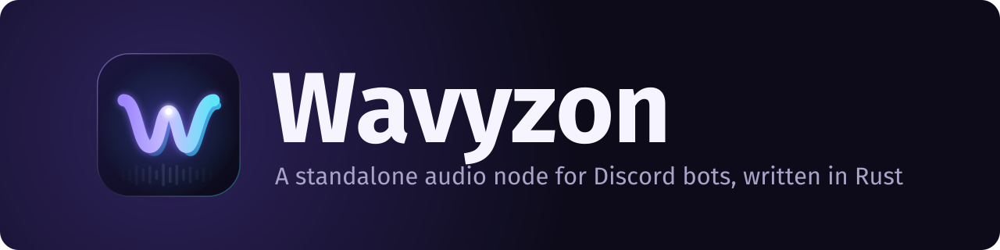

<div align="center">



<br>

### _Un nœud audio autonome pour bots Discord, écrit en Rust, précis à la trame près, avec mixage à deux platines._

<br>

[](https://www.rust-lang.org)
[](https://discord.com/developers/docs/topics/voice-connections)
[](https://daveprotocol.com)
[](docs/src/lavalink.md)
[](https://creativecommons.org/licenses/by-nc-sa/4.0/deed.fr)
<br>
[](https://gitlab.com/ihrz/wavyzon)
[](https://gitlab.com/ihrz/wavyzon/-/pipelines?ref=main)
[](https://gitlab.com/ihrz/wavyzon/-/pipelines?ref=main)
[](https://github.com/ihrz/wavyzon)

[**📚 Documentation**](docs/src/fr/introduction.md) • [**🚀 Démarrage rapide**](#demarrage-rapide) • [**⚙️ Configuration**](#configuration) • [**🧩 Plugins**](docs/src/fr/plugins.md) • [**🇬🇧 English**](README.md)

---

<div align="left">

**Wavyzon** rejoint les salons vocaux Discord, diffuse et mixe de la musique,
et indique à votre bot **exactement** quand chaque son a atteint Discord : les
paroles synchronisées restent synchronisées. Si vous avez déjà utilisé
[Lavalink](https://github.com/lavalink-devs/Lavalink), le principe est le
même : votre bot réfléchit, Wavyzon s'occupe de l'audio, et les deux se
parlent par REST et WebSocket. Wavyzon parle même le protocole v4 de
Lavalink : votre bot existant peut basculer en changeant simplement
l'adresse du nœud.

Wavyzon est une réécriture en Rust de [Cadence](https://github.com/relateful/Cadence),
le nœud audio en Go derrière *greed*, par l'équipe [iHorizon](https://gitlab.com/ihrz).

## 💡 Pourquoi Wavyzon ?

| Problème | Avec un nœud Lavalink classique | Avec Wavyzon |
| --- | --- | --- |
| **Le temps est mesuré au mauvais endroit** | La position est celle du *décodeur*, ~400 ms en avance sur le réseau ; `TrackStart` arrive avant même le téléchargement ; mises à jour toutes les 5 s ; filtres de vitesse ignorés | Une [horloge de transmission](docs/src/wire-clock.md) : chaque position est horodatée quand le paquet quitte le socket, plus un `TrackAudibleEvent` dédié |
| **Une seule piste par lecteur** | Pas de vrais fondus enchaînés ([lavalink#1093](https://github.com/lavalink-devs/Lavalink/issues/1093)) | [Deux platines](docs/src/mixing.md) intégrées : fondus armés, bass swap, balayages de filtres, calage du tempo, gapless |
| **Pannes silencieuses** | Trames perdues et blocages disparaissent sans trace | Chaque perte, blocage et erreur devient un événement, une ligne de log et une métrique |
| **Files non bornées** | La mémoire grimpe jusqu'au crash | Chaque file, cache et backlog est borné et observable |
| **Runtime lourd** | Une JVM avec plusieurs Go de heap | Un seul binaire Rust statique ; Opus lié statiquement, DAVE en Rust pur |
| **Étendre = forker** | Plugins JVM liés aux entrailles de Lavalink | Une [API de plugins](docs/src/fr/plugins.md) typée et compacte : sources, filtres, événements, routes |

## ✨ Fonctionnalités

### 🎧 **La voix Discord, bien faite**

- Passerelle vocale **v8** avec heartbeats `seq_ack`, reprise et backoff exponentiel
- Chiffrement de transport AES-256-GCM / XChaCha20-Poly1305
- **Chiffrement de bout en bout DAVE** via la crate Rust [`davey`](https://crates.io/crates/davey) : l'audio est retenu, jamais envoyé en clair
- Débit Opus par connexion (16 à 384 kb/s), réglé selon le salon

### ⏱️ **Horloge de transmission**

- Positions précises à la trame, mesurées au socket UDP
- Justes sous tous les filtres de vitesse et de tempo, pendant les fondus et après les sauts
- Synchronisation d'horloge (`/v1/clock`) et compensation du délai de lecture pour des **paroles synchronisées**

### 🎚️ **Mixeur à deux platines**

- Platine B pré-chargée, fondus armés sur la trame exacte d'un repère
- Courbes à puissance constante ou linéaires, bass swap, balayages passe-haut, calage du volume et du tempo
- `nextTrack` **sans blanc** (gapless) avec fondu enchaîné automatique de 3 s (réglable), interventions vocales de DJ avec atténuation de la musique

### 🔍 **Sources**

- **SoundCloud** : recherche, liens et lecture
- **Paroles** depuis Genius, LRCLIB (**synchronisées**, lignes horodatées) et lyrics.ovh, dans l'ordre choisi (`WAVYZON_LYRICS_ORDER`), via l'API LavaLyrics de Lavalink
- **Deezer** : recherche, liens et lecture (`DEEZER_ARL` + `DEEZER_MASTER_KEY`), sauts via `Range`
- **HTTP** : liens directs MP3 / AAC / M4A / FLAC / Ogg / WAV et **radios Icecast / Shoutcast**, sauts via `Range`, adresses privées bloquées par défaut
- **Fichiers locaux** (optionnels, confinés à `WAVYZON_LOCAL_ROOT`)
- **Spotify et Apple Music** : liens et recherche (métadonnées seulement), **mis en miroir par ISRC** vers l'enregistrement exact sur une source de lecture
- Démarrages instantanés : préchargement, caches mémoire et disque

### 🎛️ **Filtres**

- Égaliseur, timescale, karaoké, passe-bas, tremolo, vibrato, rotation de Lavalink, plus une **réverbération**
- Chaque changement **glisse** au lieu de sauter : aucun clic
- **Filtres de plugins** sous `filters.pluginFilters`

### 🧩 **API de plugins**

- Ajoutez des **sources**, des **filtres audio**, des **écouteurs d'événements** et des **routes HTTP** en quelques lignes de Rust
- Compilés via une feature cargo, activés avec `WAVYZON_PLUGINS`, configurés avec `WAVYZON_PLUGIN_<NOM>_<CLÉ>`
- Un [plugin d'exemple](plugins/wavyzon-plugin-example) complet et testé (source de sinusoïde, filtre bitcrush, compteur d'événements, route de statistiques)
- [Plugin Equalizer APO](plugins/wavyzon-plugin-apo) : lecture à travers des configs et presets APO (EQ paramétrique, GraphicEQ, convolution, reverb) avec `pluginFilters.apo`
- [Plugin Flowery TTS](plugins/wavyzon-plugin-flowery) : synthèse vocale avec les identifiants `ftts://` de LavaSrc, pour que `source: "ftts"` de lavalink-client fonctionne (activé par défaut, sans clé d'API)
- [Plugin Genius](plugins/wavyzon-plugin-genius) : paroles depuis Genius, le fournisseur suivant quand Genius n'en a pas (activé par défaut ; `WAVYZON_PLUGIN_GENIUS_ACCESS_TOKEN` recommandé)

### 🔁 **Exploitation**

- **Compatible Lavalink v4** (`/v4/*`) : fonctionne avec lavalink-client, Shoukaku, Wavelink…
- Reprise de session avec rejeu des événements, état conservé entre redémarrages
- `/metrics` Prometheus, logs JSON structurés, erreurs typées avec niveaux de gravité
- Sécurisé par défaut : pas de mot de passe par défaut, authentification en temps constant, protection SSRF, proxys par source

<a id="demarrage-rapide"></a>

## 🚀 Démarrage rapide

### 🐳 Docker (recommandé)

```bash
git clone https://gitlab.com/ihrz/wavyzon.git && cd wavyzon
cp .env.example .env            # définissez au moins WAVYZON_PASSWORD
docker compose up -d            # écoute sur 127.0.0.1:2333, données dans le volume wavyzon-data
```

### 🦀 Depuis les sources

Il faut Rust 1.85+, un compilateur C et CMake (libopus est compilée et liée
statiquement, rien d'autre à installer).

```bash
git clone https://gitlab.com/ihrz/wavyzon.git && cd wavyzon
cargo build --release -p wavyzon
WAVYZON_PASSWORD=changez-moi ./target/release/wavyzon
```

### ✅ Vérifier

```bash
curl -s -H "Authorization: changez-moi" http://localhost:2333/v1/info
curl -s -H "Authorization: changez-moi" "http://localhost:2333/v1/loadtracks?identifier=scsearch:midnight%20city"
```

Pointez ensuite votre bot vers `localhost:2333` avec le même mot de passe,
comme un nœud Lavalink v4 ou avec l'API native `/v1`. Voir
[le démarrage rapide détaillé](docs/src/fr/quick-start.md).

<a id="configuration"></a>

## ⚙️ Configuration

Tout se règle par variables d'environnement ; voir [`.env.example`](.env.example)
et la [référence complète](docs/src/configuration.md) (en anglais).

| Variable | Défaut | Description |
| --- | --- | --- |
| `WAVYZON_PASSWORD` | **obligatoire** | Secret partagé pour chaque requête. `youshallnotpass` est refusé |
| `WAVYZON_ADDRESS` | `0.0.0.0:2333` | Adresse d'écoute |
| `WAVYZON_PLAYBACK_SOURCES` | `deezer,soundcloud` | Où les pistes Spotify / Apple Music sont mises en miroir, par ordre de préférence |
| `DEEZER_ARL` + `DEEZER_MASTER_KEY` | | Activer la lecture Deezer (cookie ARL de compte et clé Blowfish de 16 octets) |
| `WAVYZON_LYRICS_ORDER` | `lrclib,lyricsovh,genius` | Fournisseurs de paroles de `/v4/lyrics` (API LavaLyrics), le premier qui répond gagne |
| `LRCLIB_ENABLED`, `LYRICS_ENABLED` | `true` | LRCLIB (paroles synchronisées) et lyrics.ovh |
| `WAVYZON_PLUGIN_GENIUS_ACCESS_TOKEN` | | Client Access Token Genius (`WAVYZON_PLUGIN_GENIUS_ENABLED=false` pour se passer de Genius) |
| `WAVYZON_HTTP_ALLOW_PRIVATE` | `false` | Autoriser la source HTTP à joindre des adresses privées / locales |
| `WAVYZON_LOCAL_ROOT` | désactivé | Dossier que la source de fichiers locaux peut lire |
| `WAVYZON_PLUGINS` | tous ceux compilés | Plugins à activer, séparés par des virgules |
| `WAVYZON_PLUGIN_<NOM>_<CLÉ>` | | Réglages d'un plugin |
| `WAVYZON_BUFFER_MS` | `10000` | Audio décodé mis en tampon par platine |
| `WAVYZON_BITRATE` | `96000` | Débit Opus par défaut |
| `WAVYZON_PLAYOUT_DELAY_MS` | `0` | Délai mesuré entre Discord et l'oreille, ajouté à `audibleAt` |
| `WAVYZON_CROSSFADE_MS` | `3000` | Fondu enchaîné automatique vers le `nextTrack` (`0` = gapless strict) |
| `WAVYZON_AUDIO_CACHE_DIR` | désactivé | Cache disque des pistes rejouées |
| `WAVYZON_STATE_FILE` | désactivé | Sauvegarde des sessions à l'arrêt, reprise au démarrage |
| `WAVYZON_LOG_LEVEL` | `info` | `debug`, `info`, `warn` ou `error` |
| `SPOTIFY_CLIENT_ID` / `_SECRET` | | Identifiants de l'API Web Spotify (métadonnées seulement) |

## 📚 Documentation

La documentation complète est un [mdBook](https://rust-lang.github.io/mdBook/)
dans [`docs/`](docs/src/SUMMARY.md) (`mdbook serve docs` pour la lire en local).
Les pages en français :

| Sujet | Page |
| --- | --- |
| 👋 Introduction | [docs/src/fr/introduction.md](docs/src/fr/introduction.md) |
| 🚀 Démarrage rapide | [docs/src/fr/quick-start.md](docs/src/fr/quick-start.md) |
| 🧩 Écrire des plugins | [docs/src/fr/plugins.md](docs/src/fr/plugins.md) |

Le reste (en anglais) : [API REST](docs/src/api/rest.md) ·
[WebSocket et événements](docs/src/api/websocket.md) ·
[Lavalink v4](docs/src/lavalink.md) · [Horloge](docs/src/wire-clock.md) ·
[Mixage](docs/src/mixing.md) · [Filtres](docs/src/filters.md) ·
[Sources](docs/src/sources.md) · [Architecture](docs/src/architecture.md) ·
[Observabilité](docs/src/observability.md) · [Déploiement](docs/src/deployment.md) ·
[Dépannage](docs/src/troubleshooting.md) ·
[Migrer depuis Lavalink](docs/src/guides/from-lavalink.md) ·
[Migrer depuis Cadence](docs/src/guides/from-cadence.md).

## 🔗 Ressources & liens

| Ressource | Lien |
| --- | --- |
| 🦊 **GitLab (principal)** | [gitlab.com/ihrz/wavyzon](https://gitlab.com/ihrz/wavyzon) |
| 🐙 **GitHub (miroir)** | [github.com/ihrz/wavyzon](https://github.com/ihrz/wavyzon) |
| 📝 **Journal des modifications** | [CHANGELOG_FR.md](CHANGELOG_FR.md) · [English](CHANGELOG.md) |
| 🤝 **Contribuer** | [CONTRIBUTING.md](CONTRIBUTING.md) |
| 🛡️ **Sécurité** | [SECURITY.md](SECURITY.md) |
| 💬 **Discord iHorizon** | [discord.ihorizon.org](http://discord.ihorizon.org/) |

## 🏆 Crédits

- **Anaïs Saraiva** et l'**équipe iHorizon**, auteurs de Wavyzon.
- [**Cadence**](https://github.com/relateful/Cadence) par *greed* (MIT) : la
  conception, le protocole et le comportement de Wavyzon viennent de Cadence,
  et une partie a été traduite de son code. Sa notice de licence est
  reproduite dans [`NOTICE`](NOTICE).
- [**Lavalink**](https://github.com/lavalink-devs/Lavalink), dont Wavyzon parle le protocole.
- Construit avec [tokio](https://tokio.rs), [axum](https://github.com/tokio-rs/axum),
  [Symphonia](https://github.com/pdeljanov/Symphonia),
  [libopus](https://opus-codec.org) via [audiopus](https://github.com/lakelezz/audiopus),
  [davey](https://crates.io/crates/davey),
  [RustCrypto AEADs](https://github.com/RustCrypto/AEADs),
  [reqwest](https://github.com/seanmonstar/reqwest),
  [tokio-tungstenite](https://github.com/snapview/tokio-tungstenite),
  [serde](https://serde.rs) et [tracing](https://github.com/tokio-rs/tracing).

## 📄 Licence & conditions d'utilisation

Wavyzon est © 2026 Anaïs Saraiva et l'équipe iHorizon, distribué sous licence
**[CC BY-NC-SA 4.0](https://creativecommons.org/licenses/by-nc-sa/4.0/deed.fr)**
(voir [`LICENSE`](LICENSE)). Les parties dérivées de Cadence restent soumises
aux termes MIT reproduits dans [`NOTICE`](NOTICE).

### ✅ **Autorisé**

✔️ **Partager** : copier et redistribuer le contenu  
✔️ **Adapter** : remixer, transformer et créer à partir du contenu, plugins compris

### ❌ **Restrictions**

❌ **Attribution** : vous devez créditer l'œuvre et indiquer les modifications  
❌ **Pas d'utilisation commerciale**  
❌ **Partage dans les mêmes conditions** : les modifications gardent la même licence  
❌ **Pas de restrictions supplémentaires** : aucune mesure légale ou technique limitant les autres

---

## ⚠️ Code de conduite

🚨 **Tolérance zéro envers la haine** visant les contributeurs et contributrices, quelle qu'en soit la forme.  
🌈 **Inclusivité** : Wavyzon est ouvert et accueillant pour tout le monde, quels que soient l'origine, l'identité de genre, l'orientation sexuelle ou toute autre caractéristique.
Voir [CODE_OF_CONDUCT.md](CODE_OF_CONDUCT.md).

</div>

---

### 🎉 Merci d'utiliser Wavyzon

<sub>Développé avec ❤️ par Anaïs Saraiva et l'équipe iHorizon</sub>

[](https://www.rust-lang.org)
[](https://tokio.rs)
[](https://github.com/pdeljanov/Symphonia)

</div>
