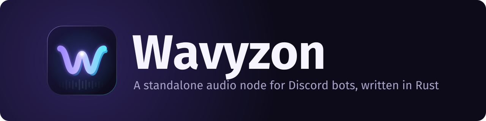

<div align="center">



<br>

### _A standalone audio node for Discord bots, written in Rust, with frame-accurate timing and two-deck mixing._

<br>

[](https://www.rust-lang.org)
[](https://discord.com/developers/docs/topics/voice-connections)
[](https://daveprotocol.com)
[](docs/src/lavalink.md)
[](https://creativecommons.org/licenses/by-nc-sa/4.0/)
<br>
[](https://gitlab.com/ihrz/wavyzon)
[](https://gitlab.com/ihrz/wavyzon/-/pipelines?ref=main)
[](https://gitlab.com/ihrz/wavyzon/-/pipelines?ref=main)
[](https://github.com/ihrz/wavyzon)

[**📚 Documentation**](docs/src/introduction.md) • [**🚀 Quick start**](#quick-start) • [**⚙️ Configuration**](#configuration) • [**🧩 Plugins**](docs/src/plugins.md) • [**🇫🇷 Français**](README.fr.md)

---

<div align="left">

**Wavyzon** joins Discord voice channels, streams and mixes music, and tells
your bot **exactly** when each sound reached Discord, so synced lyrics stay
synced. If you've used [Lavalink](https://github.com/lavalink-devs/Lavalink),
the model is familiar: your bot does the thinking, Wavyzon does the audio, and
they talk over REST and a WebSocket. It even speaks Lavalink's v4 protocol, so
your existing bot can switch by changing the node address.

Wavyzon is a Rust rewrite of [Cadence](https://github.com/relateful/Cadence),
the Go audio node behind *greed*, by the [iHorizon](https://gitlab.com/ihrz)
team.

## 💡 Why Wavyzon?

| Problem | With a classic Lavalink node | With Wavyzon |
| --- | --- | --- |
| **Timing measured in the wrong place** | Position is where the *decoder* is, ~400 ms ahead of the network; `TrackStart` fires before the stream is fetched; updates every 5 s; speed filters ignored | A [wire clock](docs/src/wire-clock.md): every position is stamped when the packet leaves the socket, plus a dedicated `TrackAudibleEvent` |
| **One track per player** | No real crossfades ([lavalink#1093](https://github.com/lavalink-devs/Lavalink/issues/1093)) | [Two decks](docs/src/mixing.md) built in: armed crossfades, bass swap, filter sweeps, tempo matching, gapless |
| **Silent failures** | Dropped frames and stalls vanish | Every drop, stall and failure is an event, a log line and a metric |
| **Unbounded queues** | Memory grows until it crashes | Every queue, cache and backlog is bounded and observable |
| **Heavy runtime** | A JVM with a multi-GB heap | One static Rust binary; Opus linked statically, DAVE in pure Rust |
| **Extending means forking** | JVM plugins tied to Lavalink internals | A small, typed [plugin API](docs/src/plugins.md) for sources, filters, events and routes |

## ✨ Features

### 🎧 **Discord voice done properly**

- Voice gateway **v8** with `seq_ack` heartbeats and resume, exponential backoff
- AES-256-GCM / XChaCha20-Poly1305 transport encryption
- **DAVE end-to-end encryption** through the pure-Rust [`davey`](https://crates.io/crates/davey) crate: audio is held, never sent unencrypted
- Per-connection Opus bitrate (16–384 kbps), set from the channel

### ⏱️ **Wire clock**

- Frame-accurate positions measured at the UDP socket
- Correct under every speed and tempo filter, through crossfades and seeks
- Clock sync (`/v1/clock`) and playout-delay compensation for **synced lyrics**

### 🎚️ **Two-deck mixer**

- Pre-buffered deck B, crossfades armed on the exact frame of a cue
- Equal-power or linear curves, bass swap, high-pass sweeps, loudness and tempo matching
- **Gapless** `nextTrack` with an automatic 3 s crossfade (configurable), DJ voice-overs with ducking

### 🔍 **Sources**

- **SoundCloud** search, links and playback
- **Lyrics** from lyrics.ovh, through Lavalink's LavaLyrics API
- **Deezer** search, links and playback (`DEEZER_ARL` + `DEEZER_MASTER_KEY`), Range-based seeking
- **HTTP**: direct MP3 / AAC / M4A / FLAC / Ogg / WAV links and **Icecast / Shoutcast radio**, Range-based seeking, private addresses blocked by default
- **Local files** (opt-in, sandboxed in `WAVYZON_LOCAL_ROOT`)
- **Spotify and Apple Music** links and search (metadata only), **mirrored by ISRC** to the exact recording on a playback source
- Instant starts: prefetch, memory and disk caches

### 🎛️ **Filters**

- Lavalink's equalizer, timescale, karaoke, low-pass, tremolo, vibrato, rotation, plus **reverb**
- Every change **glides** instead of jumping: no clicks
- **Plugin filters** under `filters.pluginFilters`

### 🧩 **Plugin API**

- Add **sources**, **audio filters**, **event listeners** and **HTTP routes** in a few lines of Rust
- Compiled in with a cargo feature, enabled with `WAVYZON_PLUGINS`, configured with `WAVYZON_PLUGIN_<NAME>_<KEY>`
- A complete, tested [example plugin](plugins/wavyzon-plugin-example) (sine-tone source, bitcrush filter, event counter, stats route)

### 🔁 **Operations**

- **Lavalink v4 compatible** (`/v4/*`), works with lavalink-client, Shoukaku, Wavelink…
- Session resume with event replay, state saved across restarts
- Prometheus `/metrics`, structured JSON logs, typed failures with severities
- Safe defaults: no default password, constant-time auth, SSRF protection, per-source proxies

<a id="quick-start"></a>

## 🚀 Quick start

### 🐳 Docker (recommended)

```bash
git clone https://gitlab.com/ihrz/wavyzon.git && cd wavyzon
cp .env.example .env            # set WAVYZON_PASSWORD at least
docker compose up -d            # listens on 127.0.0.1:2333, data in the wavyzon-data volume
```

### 🦀 From source

Needs Rust 1.85+, a C compiler and CMake (libopus is built and linked
statically, nothing else to install).

```bash
git clone https://gitlab.com/ihrz/wavyzon.git && cd wavyzon
cargo build --release -p wavyzon
WAVYZON_PASSWORD=change-me ./target/release/wavyzon
```

### ✅ Check it

```bash
curl -s -H "Authorization: change-me" http://localhost:2333/v1/info
curl -s -H "Authorization: change-me" "http://localhost:2333/v1/loadtracks?identifier=scsearch:midnight%20city"
```

Then point your bot at `localhost:2333` with the same password, as a
Lavalink v4 node or with the native `/v1` API. See
[Lavalink compatibility](docs/src/lavalink.md) for client setup.

<a id="configuration"></a>

## ⚙️ Configuration

Everything is set through environment variables; see [`.env.example`](.env.example)
and the [full reference](docs/src/configuration.md).

| Variable | Default | Description |
| --- | --- | --- |
| `WAVYZON_PASSWORD` | **required** | Shared secret for every request. `youshallnotpass` is refused |
| `WAVYZON_ADDRESS` | `0.0.0.0:2333` | Listen address |
| `WAVYZON_PLAYBACK_SOURCES` | `deezer,soundcloud` | Where Spotify / Apple Music tracks are mirrored to, in order |
| `DEEZER_ARL` + `DEEZER_MASTER_KEY` | | Enable Deezer streaming (account ARL cookie and 16-byte stream cipher key) |
| `LYRICS_ENABLED` | `true` | Lyrics from lyrics.ovh on `/v4/lyrics` (LavaLyrics API) |
| `WAVYZON_HTTP_ALLOW_PRIVATE` | `false` | Let the HTTP source fetch private / local addresses |
| `WAVYZON_LOCAL_ROOT` | off | Directory the local-file source may read |
| `WAVYZON_PLUGINS` | all compiled in | Plugins to enable, comma-separated |
| `WAVYZON_PLUGIN_<NAME>_<KEY>` | | Settings for a plugin |
| `WAVYZON_BUFFER_MS` | `10000` | Decoded audio buffered per deck |
| `WAVYZON_BITRATE` | `96000` | Default Opus bitrate |
| `WAVYZON_PLAYOUT_DELAY_MS` | `0` | Measured Discord-to-ear delay, added to `audibleAt` |
| `WAVYZON_CROSSFADE_MS` | `3000` | Automatic crossfade into the `nextTrack` (`0` = strict gapless) |
| `WAVYZON_AUDIO_CACHE_DIR` | off | Disk cache for repeat-played tracks |
| `WAVYZON_STATE_FILE` | off | Save sessions on shutdown, resume on start |
| `WAVYZON_LOG_LEVEL` | `info` | `debug`, `info`, `warn` or `error` |
| `SPOTIFY_CLIENT_ID` / `_SECRET` | | Spotify Web API credentials (metadata only) |

## 📚 Documentation

The full documentation is an [mdBook](https://rust-lang.github.io/mdBook/) in
[`docs/`](docs/src/SUMMARY.md) (`mdbook serve docs` to read it locally).

| Topic | Page |
| --- | --- |
| 📦 Installation & configuration | [Installation](docs/src/installation.md) · [Configuration](docs/src/configuration.md) |
| 🔌 Protocol | [REST API](docs/src/api/rest.md) · [WebSocket & events](docs/src/api/websocket.md) · [Lavalink v4](docs/src/lavalink.md) |
| 🎵 Audio | [Wire clock](docs/src/wire-clock.md) · [Mixing](docs/src/mixing.md) · [Filters](docs/src/filters.md) · [Sources](docs/src/sources.md) |
| 🧩 Plugins | [Writing plugins](docs/src/plugins.md) · [Example plugin](plugins/wavyzon-plugin-example) |
| 🏗️ Internals & ops | [Architecture](docs/src/architecture.md) · [Observability](docs/src/observability.md) · [Deployment](docs/src/deployment.md) · [Troubleshooting](docs/src/troubleshooting.md) |
| 🔀 Migrating | [From Lavalink](docs/src/guides/from-lavalink.md) · [From Cadence](docs/src/guides/from-cadence.md) |
| 🇫🇷 Français | [Introduction](docs/src/fr/introduction.md) · [Démarrage rapide](docs/src/fr/quick-start.md) · [Plugins](docs/src/fr/plugins.md) |

## 🏗️ Architecture

```text
crates/wavyzon            binary: config, REST + WebSocket (/v1, /v4), sessions, plugin host, metrics
crates/wavyzon-player     two decks, crossfades, gapless, filters, events, the wire clock
crates/wavyzon-voice      Discord voice gateway v8, UDP/RTP, AEAD, DAVE, the 20 ms send loop
crates/wavyzon-sources    SoundCloud, Deezer, HTTP, local, Spotify/Apple metadata, mirroring, caches
crates/wavyzon-analysis   tempo, key, phrases, sections, vocals, loudness fingerprints
crates/wavyzon-audio      PCM format, DSP, Symphonia decoding, Opus encoding
crates/wavyzon-plugin     the plugin API and shared data model
crates/wavyzon-testkit    fake voice gateway, mock sources, audio assertions
plugins/*                 plugins built with the workspace
```

## 🔗 Resources & Links

| Resource | Link |
| --- | --- |
| 🦊 **GitLab (main)** | [gitlab.com/ihrz/wavyzon](https://gitlab.com/ihrz/wavyzon) |
| 🐙 **GitHub (mirror)** | [github.com/ihrz/wavyzon](https://github.com/ihrz/wavyzon) |
| 📝 **Changelog** | [CHANGELOG.md](CHANGELOG.md) · [Français](CHANGELOG_FR.md) |
| 🤝 **Contributing** | [CONTRIBUTING.md](CONTRIBUTING.md) |
| 🛡️ **Security** | [SECURITY.md](SECURITY.md) |
| 💬 **iHorizon Discord** | [discord.ihorizon.org](http://discord.ihorizon.org/) |

## 🏆 Credits

- **Anaïs Saraiva** and the **iHorizon team**, authors of Wavyzon.
- [**Cadence**](https://github.com/relateful/Cadence) by *greed* (MIT): Wavyzon's
  design, protocol and behaviour come from Cadence, and parts were translated
  from its source. Its license notice is reproduced in [`NOTICE`](NOTICE).
- [**Lavalink**](https://github.com/lavalink-devs/Lavalink), whose protocol
  Wavyzon speaks.
- Built on [tokio](https://tokio.rs), [axum](https://github.com/tokio-rs/axum),
  [Symphonia](https://github.com/pdeljanov/Symphonia),
  [libopus](https://opus-codec.org) via [audiopus](https://github.com/lakelezz/audiopus),
  [davey](https://crates.io/crates/davey),
  [RustCrypto AEADs](https://github.com/RustCrypto/AEADs),
  [reqwest](https://github.com/seanmonstar/reqwest),
  [tokio-tungstenite](https://github.com/snapview/tokio-tungstenite),
  [serde](https://serde.rs) and [tracing](https://github.com/tokio-rs/tracing).

## 📄 License & Terms of Use

Wavyzon is © 2026 Anaïs Saraiva and the iHorizon team, distributed under
**[CC BY-NC-SA 4.0](https://creativecommons.org/licenses/by-nc-sa/4.0/)**
(see [`LICENSE`](LICENSE)). Portions derived from Cadence remain under the
MIT terms reproduced in [`NOTICE`](NOTICE).

### ✅ **Permitted**

✔️ **Share**: copy and redistribute the material  
✔️ **Adapt**: remix, transform and build upon the material, plugins included

### ❌ **Restrictions**

❌ **Attribution**: you must credit the work and indicate changes  
❌ **Non-Commercial**: no commercial use  
❌ **Share Alike**: modifications must keep the same license  
❌ **No additional restrictions**: no legal or technological measures that restrict others

---

## ⚠️ Code of Conduct

🚨 **Zero tolerance for hate** towards contributors, of any kind or level.  
🌈 **Inclusivity**: Wavyzon is open and welcoming to everyone, whatever their origin, gender identity, sexual orientation or any other characteristic.
See [CODE_OF_CONDUCT.md](CODE_OF_CONDUCT.md).

</div>

---

### 🎉 Thank you for using Wavyzon

<sub>Developed with ❤️ by Anaïs Saraiva and the iHorizon team</sub>

[](https://www.rust-lang.org)
[](https://tokio.rs)
[](https://github.com/pdeljanov/Symphonia)

</div>
