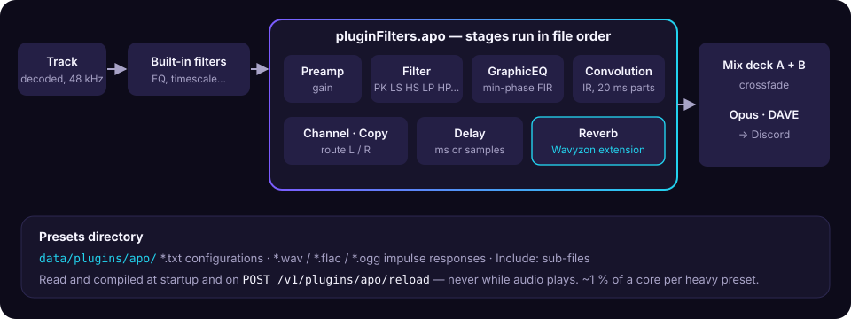

# Equalizer APO

The `apo` plugin filter plays everything through
[Equalizer APO](https://sourceforge.net/projects/equalizerapo/)
configuration files: the EQ presets people already have (AutoEQ headphone
corrections, REW room exports, hand-written parametric or graphic EQ) and
convolution reverbs. It is compiled into the default build (cargo feature
`plugin-apo`).

<figure>
  
  <figcaption>The APO filter runs on each deck after the built-in filters; presets are loaded off the audio path.</figcaption>
</figure>

## Use it

Inline, the text of a configuration:

```json
{ "filters": { "pluginFilters": { "apo": { "config": "Preamp: -6 dB\nFilter: ON PK Fc 100 Hz Gain 4 dB Q 1.41" } } } }
```

Or a preset from the presets directory, by its path without `.txt`
(lookups ignore case, as on Windows):

```json
{ "filters": { "pluginFilters": { "apo": { "preset": "headphones/hd600" } } } }
```

Removing `apo` from `pluginFilters` turns it off. Code for a bot, including
validating a user's file first: [Examples](examples.md#equalizer-apo-presets).

## Example configurations

**An AutoEQ headphone correction** (the `ParametricEQ.txt` AutoEQ publishes
for each model works as is):

```text
Preamp: -6.4 dB
Filter 1: ON LSC Fc 105 Hz Gain 6.3 dB Q 0.70
Filter 2: ON PK Fc 207 Hz Gain -2.6 dB Q 0.53
Filter 3: ON PK Fc 1554 Hz Gain 3.1 dB Q 2.35
Filter 4: ON PK Fc 3204 Hz Gain -3.9 dB Q 2.71
Filter 5: ON HSC Fc 10000 Hz Gain -2.1 dB Q 0.70
```

**A graphic EQ curve**, smooth between the points (linear in
log-frequency), flat outside them:

```text
Preamp: -4 dB
GraphicEQ: 25 4; 60 3; 150 0; 400 -1; 1000 0; 3000 1.5; 8000 2; 16000 1
```

**A light reverb** without any file (Wavyzon extension):

```text
Reverb: Mix 10 % Room 35 % Damping 65 %
```

**A convolution reverb**, the impulse response sitting next to the preset:

```text
Convolution: reverb-large-1.4s.wav
```

[`plugins/wavyzon-plugin-apo/examples`](https://gitlab.com/ihrz/wavyzon/-/tree/main/plugins/wavyzon-plugin-apo/examples)
ships that large-room reverb (decay 1.4 s, bass and treble cut on the
reverb, wet −11.8 dB) with the script that generates it, and the file-free
`Reverb:` version. Copy them to the presets directory to use them.

Lines combine in file order: EQ then reverb, a preamp before a boost, an
`Include:` of a shared file…

## Supported commands

| Command | Support |
| --- | --- |
| `Preamp` | Yes (several preamps add up in dB, as in APO) |
| `Filter` | `PK`/`Modal`/`PEQ`, `LP`, `LPQ`, `HP`, `HPQ`, `BP`, `NO`, `AP`, `LS`/`LSC` and `HS`/`HSC` (with `Q`, `BW Oct` or an `x dB` slope), `LS`/`HS 6dB` and `12dB` (corner frequency), `IIR` (order ≤ 16). `OFF` filters are skipped. |
| `GraphicEQ` | Yes: the curve becomes a minimum-phase FIR, so it adds no latency |
| `Channel` | `L`, `R`, `1`, `2`, `all` (other speakers don't exist in a stereo frame and are ignored) |
| `Copy` | Yes, with factors, `dB` factors and constants; assignments on one line are evaluated together (`Copy: L=R R=L` swaps) |
| `Delay` | `ms` or `samples`, up to 1 s |
| `Include` | Files in the presets directory, relative to the including file (`\` or `/`), up to 8 levels |
| `Convolution` | WAV, FLAC or Ogg impulse responses in the presets directory, resampled to 48 kHz if needed, up to 10 s; IR channels go to the selected channels round-robin, as in APO |
| `Reverb` | **Wavyzon extension**: `Reverb: Mix 30 % Room 70 % Damping 50 %` (values in `%` or `0`–`1`, `Reverb: off`). The same Freeverb as the built-in `reverb` filter. APO ignores unknown commands, so files that use it still load in APO. |
| `Device`, `Stage` | Ignored (warning): the filter applies to whatever the player plays |
| `If`/`ElseIf`/`Else`/`EndIf`, `Eval`, inline `` `expressions` `` | Not evaluated: the block or line is skipped (warning) |

A malformed line of a known command is skipped with a warning, as APO skips
it. A missing `Include`/`Convolution` file, a delay over 1 s or more than
512 filters fail the update with `400`.

## Presets directory

`WAVYZON_PLUGIN_APO_DIR`, by default `$WAVYZON_DATA_DIR/plugins/apo`
(`data/plugins/apo/` on a [Pelican server](guides/pelican.md#files-on-the-server)).
Put `.txt` configurations there, and the impulse responses they use:

```text
data/plugins/apo/
├── headphones/
│   ├── hd600.txt
│   └── common/tilt.txt        Include: common\tilt.txt from hd600.txt
├── reverb-large.txt
└── reverb-large-1.4s.wav      Convolution: reverb-large-1.4s.wav
```

The directory, its impulse responses and every preset are read and compiled
at startup and on `POST /v1/plugins/apo/reload`, never while audio plays.
Paths can't leave the directory and symbolic links are not followed.

| Route | |
| --- | --- |
| `GET /v1/plugins/apo/` | Presets (stages, skipped lines, or why one can't be used), impulse responses, directory warnings |
| `POST /v1/plugins/apo/reload` | Re-read the directory (new and edited files) |
| `POST /v1/plugins/apo/check` | Compile `{"config": "..."}` or `{"preset": "..."}`: `200` with the stages and warnings, or `400` with the error |

## Performance and latency

- Convolution and GraphicEQ run in 20 ms partitions aligned on the player's
  frames: no added latency, so the [wire clock](wire-clock.md) stays exact.
- A heavy preset (10 peaking filters, a GraphicEQ, a 3 s stereo impulse
  response and the reverb) costs about 1 % of one core per playing deck.
  All convolutions and GraphicEQs of one configuration are limited to about
  20 s of impulse response per channel.
- Like other plugin filters, changing the configuration builds a new
  instance and crossfades to it. Boosts can clip: add a `Preamp`.
