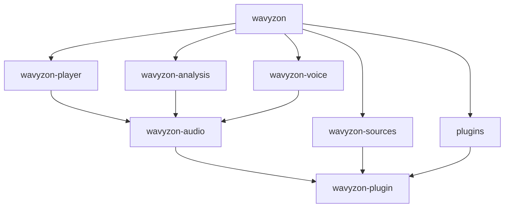

# Architecture

Wavyzon is a Cargo workspace. Each crate has one job and depends only on
the crates below it.

## Crate map

| Crate | Role |
| --- | --- |
| [`wavyzon`](https://gitlab.com/ihrz/wavyzon/-/tree/main/crates/wavyzon) | The binary: configuration, REST + WebSocket server (`/v1`, `/v4`), sessions and resume, plugin host, metrics, graceful shutdown |
| [`wavyzon-player`](https://gitlab.com/ihrz/wavyzon/-/tree/main/crates/wavyzon-player) | Two-deck player: decks, crossfades, gapless, filters and their ramps, reverb, loudness, plugin filter chains, events, the wire clock |
| [`wavyzon-voice`](https://gitlab.com/ihrz/wavyzon/-/tree/main/crates/wavyzon-voice) | Discord voice: gateway v8, UDP/RTP transport, AEAD, DAVE end-to-end encryption, the 20 ms send loop |
| [`wavyzon-sources`](https://gitlab.com/ihrz/wavyzon/-/tree/main/crates/wavyzon-sources) | Built-in sources (SoundCloud, HTTP, local, Deezer, Spotify, Apple Music), the resolver, mirroring and match scoring, prefetch, memory and disk caches, per-source HTTP clients |
| [`wavyzon-analysis`](https://gitlab.com/ihrz/wavyzon/-/tree/main/crates/wavyzon-analysis) | Track analysis: tempo, beats, meter, key, phrases, sections, vocals, loudness fingerprints; offline queue |
| [`wavyzon-audio`](https://gitlab.com/ihrz/wavyzon/-/tree/main/crates/wavyzon-audio) | The PCM format (48 kHz, stereo, 20 ms frames of `i16`), DSP building blocks (biquads, resampler, stretcher), Symphonia decoding, the Opus encoder, the `FrameSource` hand-off trait |
| [`wavyzon-plugin`](https://gitlab.com/ihrz/wavyzon/-/tree/main/crates/wavyzon-plugin) | The plugin API **and** the shared data model: `Track`, `LoadResult`, `Failure`, `Event`, source and filter traits |
| [`wavyzon-testkit`](https://gitlab.com/ihrz/wavyzon/-/tree/main/crates/wavyzon-testkit) | Test helpers: a fake Discord voice gateway, mock sources, audio assertions |
| [`plugins/*`](https://gitlab.com/ihrz/wavyzon/-/tree/main/plugins) | Plugins built with the workspace, starting with `wavyzon-plugin-example` |

```text
                    ┌────────────────────────────────────────────────┐
                    │                    wavyzon                     │  binary
                    └──┬─────────┬─────────┬──────────┬─────────┬────┘
                       │         │         │          │         │
                       ▼         ▼         ▼          ▼         ▼
         ┌──────────────┐ ┌────────────┐ ┌──────────┐ ┌─────────────┐ ┌───────────┐
         │wavyzon-player│ │wavyzon-    │ │wavyzon-  │ │wavyzon-     │ │ plugins/* │
         │              │ │voice       │ │analysis  │ │sources      │ │           │
         └──────┬───────┘ └─────┬──────┘ └────┬─────┘ └──────┬──────┘ └─────┬─────┘
                │               │             │              │              │
                ▼               ▼             ▼              │              │
         ┌─────────────────────────────────────────┐         │              │
         │              wavyzon-audio              │         │              │
         └────────────────────┬────────────────────┘         │              │
                              ▼                              ▼              ▼
         ┌─────────────────────────────────────────────────────────────────────┐
         │                          wavyzon-plugin                             │
         └─────────────────────────────────────────────────────────────────────┘
```

`wavyzon-plugin` is at the bottom on purpose: built-in sources implement the
**same** `Source` trait as plugin sources, and the player emits the **same**
`Event` type that listeners receive. Plugins are not second-class.



## Data flow: playing a track

```text
 bot                     wavyzon (api/session)        player                    sources              voice
  │ PATCH player {track}        │                        │                          │                    │
  │────────────────────────────►│ decode track           │                          │                    │
  │                             │───────────────────────►│ TrackLoadingEvent        │                    │
  │◄────────────── event ───────│◄───────────────────────│                          │                    │
  │                             │                        │ resolve (mirror by ISRC) │                    │
  │                             │                        │─────────────────────────►│                    │
  │                             │                        │ Playable::open(start_ms) │                    │
  │                             │                        │◄──── Stream ─────────────│                    │
  │◄────────────── event ───────│◄───── TrackStartEvent ─│ decode task fills deck   │                    │
  │                             │                        │ buffer (WAVYZON_BUFFER_MS)                    │
  │                             │                        │                          │  every 20 ms:      │
  │                             │                        │◄──────────── next_frame() ────────────────────│
  │                             │                        │ mix + filters + volume ──────── Frame ───────►│ opus → DAVE
  │                             │                        │                          │                    │ → AEAD → UDP
  │                             │                        │◄───────── sent(FrameInfo, instant) ───────────│
  │◄────────────── event ───────│◄─── TrackAudibleEvent ─│ (first frame only)       │                    │
  │◄── playerUpdate (anchor) ───│                        │                          │                    │
```

### The real-time path

The send loop in `wavyzon-voice` is the only real-time component. Every
20 ms it:

1. asks the player for exactly one frame, already decoded, filtered and
   mixed, through `wavyzon_audio::FrameSource::next_frame`, which also
   returns the frame's `FrameInfo` (instance, fractional source position,
   whether a crossfade is running);
2. encodes it with Opus (one encoder per connection);
3. encrypts it with DAVE (when the call negotiated E2EE) and the transport
   AEAD (`aead_aes256_gcm_rtpsize`, falling back to
   `aead_xchacha20_poly1305_rtpsize`);
4. writes it to the UDP socket and calls `FrameSource::sent(info, instant)`:
   that is the [wire clock](wire-clock.md). Lateness is reported with
   `FrameSource::stall(gap)`.

Everything slow (HTTP, decoding, analysis, plugin listeners) happens on other
tasks and reaches the send loop only through bounded buffers. If the buffer
is empty, the loop sends silence and the player reports buffering
(`sounding: false`, and after 10 s `TrackStuckEvent`); if the loop itself is
late, it reports `SendStallEvent`.

### Voice connections

- One Opus encoder, sender, UDP socket and DAVE session per connection, torn
  down together.
- Voice gateway v8 with `seq_ack` heartbeats and resume; reconnects use
  exponential backoff and resume when possible, so audio keeps flowing
  through gateway blips.
- DAVE: MLS commits, welcomes, proposals and protocol transitions, through
  the pure-Rust [`davey`](https://crates.io/crates/davey) crate. While an E2EE
  epoch is not ready, audio is **held**, never sent unencrypted; a hold that
  lasts 15 s restarts the voice session. Calls without E2EE (DAVE protocol 0)
  play straight away.
- A voice update with the same session is ignored; a new one closes the old
  connection and waits for its sender to exit before dialing.

### Sessions

```text
WebSocket connect ──► Session (id, user id, protocol v1|v4)
                         ├─ Guild players (one per guild)
                         ├─ outbound queue ──► socket
                         └─ on disconnect: if resuming, keep players and buffer up to 2 000 messages
                                           for `timeout` seconds; else destroy players
```

With `WAVYZON_STATE_FILE`, sessions and players are written to disk on
graceful shutdown and restored on start, so a deploy resumes playback where it
stopped.

### Bounded everything

Every queue, cache and backlog has a limit and a metric: deck buffers
(`WAVYZON_BUFFER_MS`), prefetch queue, analysis queue
(`WAVYZON_ANALYSIS_QUEUE`), resume backlog (2 000 messages), memory caches
(TTL LRU), disk cache (`WAVYZON_AUDIO_CACHE_GB`). Nothing grows without bound
under load; it drops, counts and logs instead.

## Design choices

| Choice | Why |
| --- | --- |
| Rust, tokio | Predictable latency (no GC pauses on the send path), memory safety, one static binary |
| Symphonia | Pure-Rust decoding of every common format; no ffmpeg |
| Static libopus | The reference Opus encoder, with per-connection bitrate (16–384 kbps), but no runtime dependency |
| `davey` | DAVE in Rust: no `libdave` to build or ship, no FFI |
| Two decks in the player | Crossfades are a player feature, not a hack on top of a single-track player |
| Measure time at the socket | The only place where "position" means what people hear |
| Compiled-in plugins | Type-safe, zero-cost on the audio path, no ABI issues |
