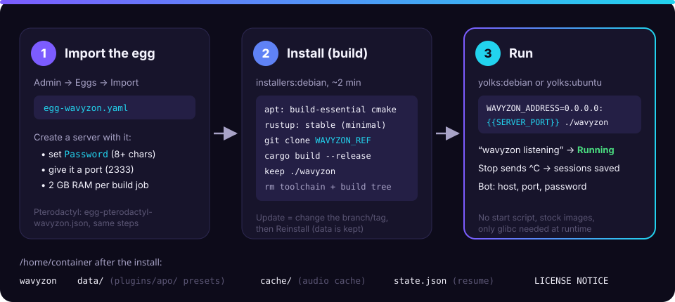

# Deploy on Pelican

Wavyzon ships an egg for [Pelican](https://pelican.dev) (and
[Pterodactyl](https://pterodactyl.io), same steps): the panel builds the node
from source and runs it like any game server. It uses only the stock
pelican-eggs images and no start script.

<figure>
  
  <figcaption>Import once, then every server installs by building from source and runs the bare binary.</figcaption>
</figure>

## What you need

| | |
| --- | --- |
| Panel | Pelican, or Pterodactyl 1.x |
| Egg file | [`egg-wavyzon.yaml`](https://gitlab.com/ihrz/wavyzon/-/raw/main/contrib/pelican/egg-wavyzon.yaml) (Pelican) or [`egg-pterodactyl-wavyzon.json`](https://gitlab.com/ihrz/wavyzon/-/raw/main/contrib/pelican/egg-pterodactyl-wavyzon.json) (Pterodactyl) |
| Memory | ~1.5 GB per build job **during the install** (2 jobs by default); afterwards little: ~2 MB per deck of each playing player, plus caches (see [Sizing](../deployment.md#sizing)) |
| Disk | ~3 GB during the install (toolchain and build, deleted at the end), then ~25 MB + the audio cache (5 GB by default) |
| Network | One TCP port for your bot; voice is outbound UDP only |

## 1. Import the egg

1. Download the egg file (links above).
2. **Admin → Eggs → Import**, and pick the file. (The URL import field may
   refuse GitLab links: upload the file instead.)
3. Save. The egg appears as **Wavyzon**, with its icon.

> **Note** — If the icon doesn't show, the panel's public storage link is
> missing: run `php artisan storage:link` in the panel's folder (often
> `/var/www/pelican`), fix the owner of `storage/`, and import again.
> Importing again updates the same egg (same UUID); it never duplicates it.

## 2. Create the server

**Admin → Servers → Create**, egg **Wavyzon**, then:

| Setting | Value |
| --- | --- |
| Memory | 3072 MB is comfortable for the build; you can lower it afterwards |
| Port | Any free port, e.g. `2333`: Wavyzon listens on it (`0.0.0.0:{{SERVER_PORT}}`) |
| **Password** | 8+ characters, not `youshallnotpass`. Your bot uses it as the Lavalink password |
| Branch or tag | `main` (default) or a release tag |
| Build jobs | `2`; lower to `1` if the install is killed for lack of memory |

Every other variable maps to a [configuration](../configuration.md) setting
and can stay at its default (Deezer first, SoundCloud fallback, 3 s automatic
crossfade, loudness normalisation…).

## 3. Install and start

The install runs in `ghcr.io/pelican-eggs/installers:debian` and takes a few
minutes: CMake and a C compiler, a minimal Rust toolchain from rustup, a
shallow `git clone` of the branch, `cargo build --release`. It ends with
`Installation complete.` and leaves only the binary on the server.

Start the server. The console shows the configuration warnings (missing
Spotify keys…) and then:

```text
INFO wavyzon: wavyzon listening address=0.0.0.0:2333 version="0.2.0" sources=[…] plugins=["example", "apo", "flowery", "genius"] dave=true
```

The panel switches to **Running** on that line. **Stop** sends `^C`: the node
saves its sessions to `state.json` and resumes them on the next start, so a
restart doesn't drop the music for long.

## 4. Point your bot at it

Use the server's address and port with the password, exactly like a Lavalink
node:

```ts
nodes: [{ id: "wavyzon", host: "panel-node.example.com", port: 2333, authorization: "your-password" }]
```

Check from your machine:

```bash
curl -s -H "Authorization: your-password" http://panel-node.example.com:2333/v1/info
```

See [Examples](../examples.md) for complete bot code.

## Updating

Change **Branch or tag** if you want another version, then **Reinstall** the
server. The data directory, the audio cache, `state.json` and your APO
presets are kept; only the binary is rebuilt.

## Files on the server

```text
/home/container
├── wavyzon            the node
├── data/
│   └── plugins/apo/   Equalizer APO presets (.txt) and impulse responses (.wav)
├── cache/             audio cache (WAVYZON_AUDIO_CACHE_GB)
├── state.json         sessions saved on shutdown
├── LICENSE
└── NOTICE
```

To use [Equalizer APO](../apo.md) presets, upload them to
`data/plugins/apo/` with the panel's file manager and restart the server.

## Troubleshooting

| Symptom | Fix |
| --- | --- |
| Install stops with `Killed` or `signal: 9` during `cargo build` | Not enough memory: give the server more RAM for the install, or set **Build jobs** to `1`. |
| `could not clone … at …` | The branch or tag doesn't exist. Private fork: set the Git token variable (admin only). |
| The server stays **Starting** | The console has an error before `wavyzon listening`, usually a missing or rejected **Password**. |
| Bot gets `401` | The bot's `authorization` differs from the server's Password variable. |
| Bot can't connect at all | Wrong port, or the node's firewall blocks it. The allocation must be reachable from the bot. |
| No egg icon | `php artisan storage:link` on the panel (see step 1). |

The egg's sources (install script, generator, variable list) are in
[`contrib/pelican`](https://gitlab.com/ihrz/wavyzon/-/tree/main/contrib/pelican).
