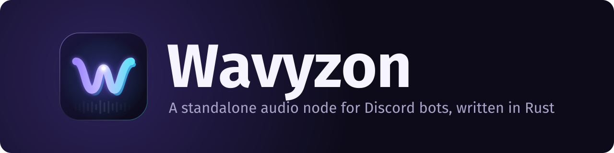
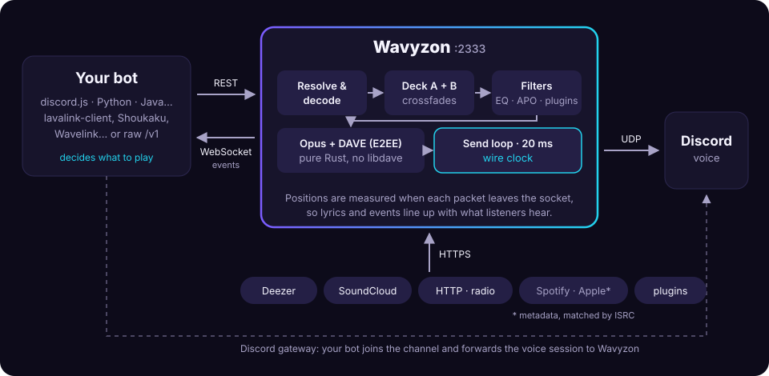

# Introduction

**Wavyzon** is a standalone audio node for Discord bots, written in Rust. It
joins voice channels, streams and mixes music, and tells your bot *exactly*
when each sound reached Discord.

  
<strong>🎯 Wire clock</strong>
Positions measured at the socket: lyrics and visuals line up with what people hear.

  
<strong>🎚️ Two-deck mixing</strong>
Crossfades, gapless and automatic transitions, DJ voice-overs.

  
<strong>🔌 Lavalink v4</strong>
lavalink-client, Shoukaku, Wavelink… connect unchanged.

  
<strong>🎛️ Equalizer APO</strong>
Play through APO presets: EQ, GraphicEQ, convolution, reverb.

  
<strong>🔒 DAVE in pure Rust</strong>
End-to-end encrypted voice, one static binary, no libdave.

  
<strong>🧩 Plugins</strong>
Sources, filters, event listeners and HTTP routes in a few lines.

New here? Start with the [Quick start](quick-start.md), or
[deploy it on Pelican](guides/pelican.md) in a few clicks.

If you have used [Lavalink](https://github.com/lavalink-devs/Lavalink), the
model is the same: **your bot does the thinking, Wavyzon does the audio**, and
they talk over a REST API and a WebSocket. Wavyzon even speaks Lavalink's own
v4 protocol, so most existing bots can switch without code changes.

Wavyzon is a Rust rewrite of [Cadence](https://github.com/relateful/Cadence), the
Go audio node behind *greed*. It keeps Cadence's protocol and its two big
ideas, the [wire clock](wire-clock.md) and [two-deck mixing](mixing.md), and
adds:

- a **plugin API** ([`wavyzon-plugin`](plugins.md)) to add sources, filters,
  event listeners and HTTP routes without forking the node;
- an **HTTP audio source**: direct links to MP3/AAC/M4A/FLAC/Ogg/WAV files
  and Icecast/Shoutcast radio, with Range-based seeking;
- optional **local files**;
- a **pure-Rust** media stack: [Symphonia](https://github.com/pdeljanov/Symphonia)
  for decoding, libopus built statically, and DAVE end-to-end encryption
  through the [`davey`](https://crates.io/crates/davey) crate. No `libdave`,
  no cgo, no JVM: one static binary;
- this book.

## How it fits together

<figure>
  
  <figcaption>Your bot decides what to play; Wavyzon fetches, mixes, filters and sends the audio.</figcaption>
</figure>

1. Your bot opens a WebSocket to Wavyzon and receives a `sessionId`.
2. It resolves something to play with `GET /v1/loadtracks`.
3. When Discord sends your bot the voice server and voice state for a guild,
   the bot forwards them to Wavyzon in a player update, together with the track.
4. Wavyzon connects to Discord voice, streams, and reports events
   (`TrackStartEvent`, `TrackAudibleEvent`, `TrackEndEvent`…) over the WebSocket.

## Where to go next

| I want to… | Read |
| --- | --- |
| Get a node playing in ten minutes | [Quick start](quick-start.md) |
| Run it on a Pelican / Pterodactyl panel | [Deploy on Pelican](guides/pelican.md) |
| Copy working code for my bot | [Examples](examples.md) |
| Use my Equalizer APO presets (EQ, reverb…) | [Equalizer APO](apo.md) |
| Make the bot speak (text-to-speech, `ftts://`) | [Flowery TTS](flowery-tts.md) |
| Show lyrics (Genius, then lyrics.ovh) | [Genius lyrics](genius-lyrics.md) |
| Run a node | [Installation](installation.md), then [Configuration](configuration.md) |
| Point an existing Lavalink bot at Wavyzon | [Lavalink v4 compatibility](lavalink.md) |
| Write a client against the native protocol | [REST API](api/rest.md) and [WebSocket & events](api/websocket.md) |
| Show synced lyrics | [The wire clock](wire-clock.md) |
| Build automix / DJ transitions | [Mixing & crossfades](mixing.md) |
| Add my own source or effect | [Writing plugins](plugins.md) |
| Run it in production | [Deployment](deployment.md) and [Observability](observability.md) |

## Status of this documentation

Wavyzon is young. The protocol is inherited from Cadence and stable; some
names that are new to Wavyzon (a few environment variables, metric names) may
still change before 1.0. Those are marked like this:

> Note: provisional

## License

Wavyzon is © 2026 Anaïs Saraiva and the iHorizon team, distributed under
[CC BY-NC-SA 4.0](https://creativecommons.org/licenses/by-nc-sa/4.0/). It is a
derived work of Cadence (MIT, © 2026 greed); see `NOTICE` in the repository.
